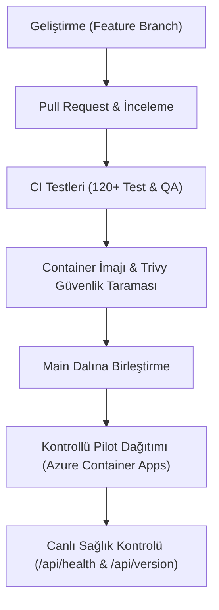

# CloudShield MSSP Platform - Kod İnceleme ve Sürüm Kalite Süreci

Bu belge, CloudShield platformunun sürüm yayınlama, kod inceleme ve kalite güvence adımlarını açıklar.

---

## 1. Sürüm Kalite İlkeleri

Her sürüm ve kod değişikliği aşağıdaki standartlara uymak zorundadır:

1. **Çift Göz Prensibi (Code Review):**
   - Kod değişiklikleri doğrudan `main` dalına push edilmez.
   - Değişiklikler ilgili özellik dalında (`feature/*` veya `fix/*`) geliştirilir ve Pull Request (PR) üzerinden incelenir.

2. **Otomatik Test Doğrulaması:**
   - Tüm birim, RBAC, tenant izolasyonu ve mutabakat testleri CI/CD pipeline üzerinde hatasız tamamlanmalıdır.
   - Testleri geçmeyen hiçbir PR birleştirilemez.

3. **Güvenlik ve Bağımlılık Taraması:**
   - Container imajı derlendikten sonra güvenlik açığı taraması (Trivy) çalıştırılır.
   - Her imaj için SPDX standardında SBOM (Software Bill of Materials) üretilerek arşivlenir.

---

## 2. Dağıtım ve Yayın Akışı

---

## 3. Sürüm Doğrulama Kriterleri

Bir sürümün kontrollü pilota çıkabilmesi için:
- Depoda hiçbir açık metin kimlik bilgisi veya test kalıntısı bulunmamalıdır.
- Veri tabanı şeması ve migrasyon dosyaları (`database/migrations/`) geriye dönük uyumlu olmalıdır.
- Raporlarda eksik veri durumunda sentetik sayı yazılmamalı, durum açıkça `N/A` veya `Yapılandırılmamış` olarak belirtilmelidir.
- Azure üzerinde dağıtılan container tek replika (`MAX_REPLICAS=1`) kuralıyla çalışmalıdır.
